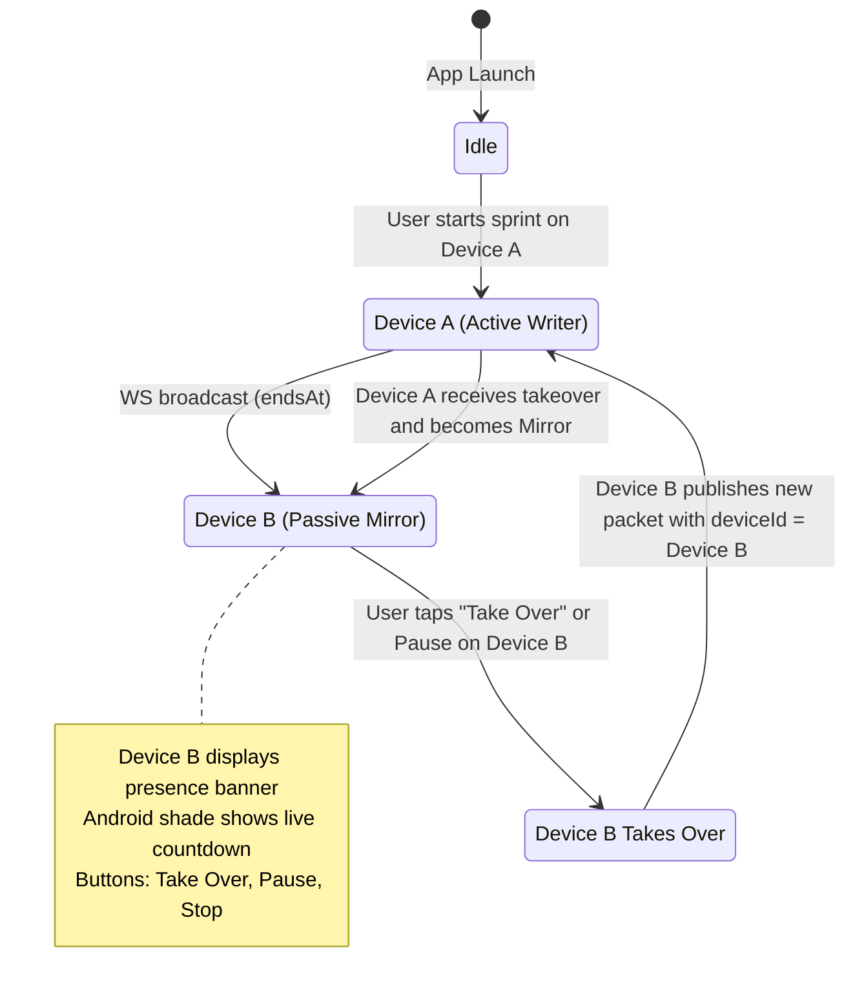

# Explanation: Target Timestamp Sync Model and Session Handover

This document explains the architectural principles, mathematical formulation, and synchronization protocols behind Pomo's multi-device real-time countdown sync and session handover engine.

---

## 1. The Distributed Timer Challenge

Building a real-time countdown timer that stays in sync across desktop computers (macOS), mobile phones (Android), and browser web apps (PWA) introduces fundamental distributed systems challenges:

### Why Naive Ticking Over WebSockets Fails

The most naive approach to synchronizing a countdown timer is streaming a tick message over a network socket every second:

```
[Device A] --- (24:59) ---> [Server] --- (24:59) ---> [Device B]
[Device A] --- (24:58) ---> [Server] --- (24:58) ---> [Device B]
[Device A] --- (24:57) ---> [Server] --- (24:57) ---> [Device B]
```

This architecture breaks down in real-world mobile environments:

1. **Network Jitter and Packet Drops**: Cellular connections experience variable latency (50ms to over 800ms). Packets arrive in bursts or out of order, causing the countdown on Device B to freeze, stutter, or jump backward.
2. **Aggressive Mobile OS Power Management**: When Android or iOS screens turn off, the operating system throttles background networking, dropping persistent TCP connections or batching wake-ups.
3. **Bandwidth and Server Saturation**: 1,000 active users streaming 1 tick per second results in 2,000 to 3,000 network round-trips every second, driving unnecessary compute cost and battery drain.
4. **Offline Isolation**: If a device enters an elevator or tunnel for 15 seconds, a streaming ticker loses those 15 seconds of progress entirely.

---

## 2. The Target Timestamp Paradigm

Pomo solves this problem by synchronizing **intent and target boundaries** rather than individual seconds.

Instead of broadcasting current remaining seconds continuously, the active device transmits an absolute wall-clock target timestamp:

$$\text{endsAt} = \text{now}() + \text{remainingDuration}$$

```
+-------------------------------------------------------------+
| Active Device (e.g. macOS)                                  |
|   - Starts 25-minute sprint                                 |
|   - Computes: endsAt = 2026-10-21T12:25:00.000Z             |
|   - Sends ONE event packet over WebSocket                   |
+------------------------------+------------------------------+
                               |
                               v
+-------------------------------------------------------------+
| Cloudflare Durable Object (SyncRoom)                        |
|   - Stores endsAt in memory                                 |
|   - Computes: liveRemaining = max(0, endsAt - now())         |
|   - Fans out to all connected peers (<20ms)                 |
+------------------------------+------------------------------+
                               |
                               v
+-------------------------------------------------------------+
| Passive Device (e.g. Android)                               |
|   - Receives endsAt target                                  |
|   - Starts local monotonic 1-second ticker                  |
|   - Smoothly decrements remainingSeconds on device          |
+-------------------------------------------------------------+
```

### Invariants and State Packet Structure

A Pomo sync packet contains:

```json
{
  "deviceId": "dev_1792561929724_646095",
  "deviceName": "macOS",
  "status": "running",
  "lap": "work",
  "lapNumber": 1,
  "remainingSeconds": 1500,
  "totalSeconds": 1500,
  "tagName": "Deep Work",
  "tagIcon": "⚡",
  "taskTitle": "Architecture Spec",
  "updatedAt": "2026-10-21T12:00:00.000Z",
  "endsAt": "2026-10-21T12:25:00.000Z",
  "liveRemaining": 1500,
  "isRunning": true
}
```

### Mathematical Guarantee of Accuracy

When any client or the Edge worker needs to determine the exact remaining time, it computes:

$$\Delta t = \left\lfloor \frac{\text{endsAt} - \text{currentTime}}{1000} \right\rfloor$$

$$\text{remainingSeconds} = \max(0, \Delta t)$$

This guarantees:
- **Zero Drift Across Time Zones**: `endsAt` is stored in UTC ISO-8601 or millisecond epoch format. Timezone offsets do not affect the countdown.
- **Instant Recovery After Disconnection**: If Device B loses Wi-Fi for 20 seconds and reconnects, it immediately recalculates $\text{endsAt} - \text{currentTime}$. The countdown is mathematically exact without missing ticks.
- **Clock Skew Tolerance**: The Cloudflare Edge Worker evaluates `liveRemaining` on every request. Even if a client device clock is slightly out of sync with NTP, the Edge calculation provides a reliable consensus timestamp.

---

## 3. Local Monotonic Ticking (`_startRemoteTick`)

While network state packets are only broadcast when events occur (plus a low-frequency 10-second heartbeat), users expect the countdown to update smoothly every second on their phone screen and in the Android notification shade.

Pomo bridges network events and visual continuity through `RemoteSessionService._startRemoteTick()`:

1. When a `SESSION_UPDATE` packet arrives, Pomo initializes a local in-memory `RemoteSession` model.
2. If `session.isRunning == true`, Pomo starts a local Dart periodic timer ticking at 1,000ms intervals.
3. On each local tick:
   - `remainingSeconds` is decremented by 1 second locally.
   - The UI presence banner (`RemoteSessionPresenceBanner`) updates reactively.
   - On Android, `AndroidNotificationService().showRunningRemoteNotification(session)` updates the notification shade tile.
4. When a new authoritative packet arrives from the network or heartbeat, the local ticker synchronizes smoothly with the server's calculated `liveRemaining`, eliminating cumulative drift.

---

## 4. Session Handover and Omnidirectional Takeover Protocol

Pomo supports seamless session takeover as users transition between devices (for example, starting a sprint at a desk on macOS and moving away with an Android phone).

### Device Ownership and Attribution

Each client generates a persistent unique `deviceId` on startup:

$$\text{deviceId} = \text{dev\_} + \text{timestamp} + \text{\_} + \text{random}$$

Along with a human-readable `deviceName` (`macOS`, `Android`, `Web PWA`).

### Handover State Machine



### Handover Scenarios

1. **Mirroring Only**:
   - Device A runs a session.
   - Device B receives updates and renders a top presence pill banner: `⚡ Deep Work (22:15) running on macOS`.
   - On Android, the shade tile mirrors the countdown.
2. **Remote Pause / Stop**:
   - Tapping **Pause** or **Stop** on Device B sends a state update packet to Cloudflare.
   - Cloudflare Durable Object updates `SyncRoom` state and notifies all peers.
   - Device A pauses or resets immediately.
3. **Session Takeover (Device B claims ownership)**:
   - The user taps **Take Over** on Device B.
   - Device B's local `TimerCubit` imports the active session duration, lap number, and tag.
   - Device B assumes role of primary countdown driver (`deviceId = Device B`).
   - Device A receives the updated packet and transitions to passive mirror mode.

---

## 5. Cloudflare Durable Objects vs Stateless Serverless

Real-time timer synchronization requires persistent state and instant fanout. Pomo uses Cloudflare Durable Objects (`SyncRoom`) rather than standard stateless serverless functions (like AWS Lambda or Vercel Serverless Functions):

| Dimension | Ephemeral Serverless Function | Cloudflare Durable Object (`SyncRoom`) |
|---|---|---|
| **Lifecycle** | Shuts down after each request | Long-lived actor instance pinned in memory |
| **WebSockets** | Requires external pub/sub service | Native WebSocket termination and connection pool |
| **Edge Latency** | 100ms to 400ms cold start latency | Sub-20ms edge response globally |
| **State Storage** | Requires database read/write on every event | In-memory session object with zero disk I/O |
| **Fanout Cost** | Multiple DB writes and poller loops | Instant zero-cost broadcast to open sockets |

---

## 6. Android Notification Shade Integration

On Android, displaying a remote countdown tile in the notification shade requires navigating modern background execution restrictions:

- **Special-Use Foreground Service (FGS)**: Under Android 14+ (API 34+), background services must declare specific types. Pomo uses `SPECIAL_USE` for timer coordination.
- **Fail-Safe Notification Fallback**: When an Android device is backgrounded and receives a WebSocket packet, starting an FGS directly can be restricted by Android 14+ background start policies. Pomo's native layer wraps `startForeground()` in a try-catch block: if background start is restricted, it immediately falls back to direct `NotificationManager.notify()`.
- **Result**: The user always sees their active countdown tile in the shade regardless of whether the Flutter engine is foregrounded or dormant.
